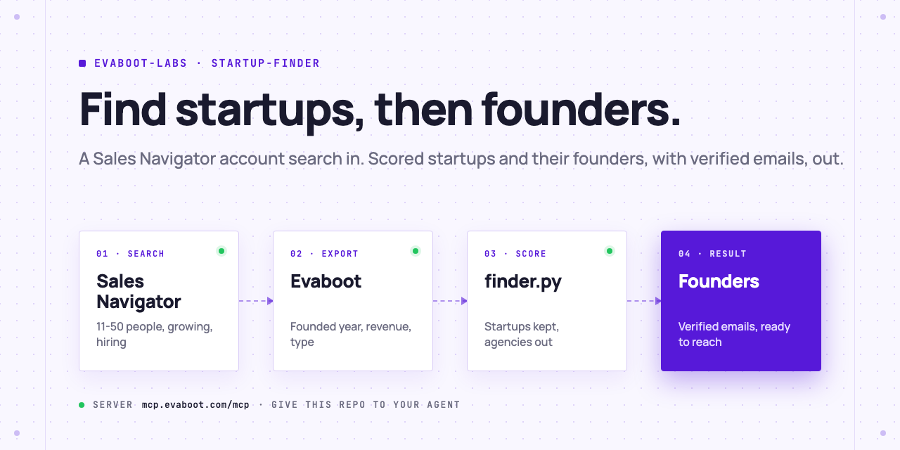

<picture>
  <source media="(prefers-color-scheme: dark)" srcset=".github/assets/banner-dark.png">
  
</picture>

# Startup finder

Your AI agent finds startups on LinkedIn: it runs a Sales Navigator account search for young, growing companies, scores each one as a startup (founded year, headcount growth, revenue, company type, services firms out), then exports the founders and C-level of the startups it keeps, with verified emails. You do the outreach.

[](AGENTS.md)
[](https://evaboot.com/mcp)
[](LICENSE)

## Set it up in one prompt

Paste this into Claude Code, Codex or Cursor:

```text
Clone https://github.com/evaboot-labs/startup-finder, read AGENTS.md and follow the skill. Find startups I can sell to, and their founders.
```

<details>
<summary>Or install the skill</summary>

Claude Code:

```text
/plugin marketplace add evaboot-labs/startup-finder
/plugin install startup-finder@evaboot-labs-startup-finder
```

Codex, Cursor and other agents:

```bash
npx skills add evaboot-labs/startup-finder
```

</details>

## How it works

**1. Search accounts, not people.** Your agent writes your market into [`STARTUPS.md`](STARTUPS.md) and builds a Sales Navigator account search with Evaboot: headquarters, industry, 11 to 50 people, headcount growth of 20% or more, hiring on LinkedIn. Sales Navigator has no "startup" filter, and the keyword "startup" cut our search from 475 companies to 1.

**2. Score every company as a startup.** The export holds what the filters cannot check: the founded year, revenue and company type. `finder.py` gives points for each, and takes points off a company whose description reads like a consulting firm or an agency.

```text
$ python3 finder.py score data/accounts.json
| yes | 8 | Qubrid AI    | 2024 | 11 to 50 | 80% | founded 2024; +80% staff in 1 year; revenue under $2M; privately held |
| no  | 1 | Bellwood     | 2019 | 11 to 50 | 30% | founded 2019, before 2020; ...; reads like a services firm (consulting, consultancy) |
| no  |   | TheCorporate | 2024 | 11 to 50 | 57% | Sole Proprietorship, not a venture startup |

5 of 10 companies kept.
```

**3. Then the founders.** `finder.py people-url` turns the kept startups into a people search for owners, founders and C-level. In our test it found 12 people at the 5 startups; the export of 10 kept 9 inside the filters, 6 of them with a safe email.

**4. Or run it in n8n.** Every Monday, the companies new to your search are scored and their founders land in a Google Sheet. No AI key needed.

## What you need

- An [Evaboot account](https://dash.evaboot.com/accounts/signup/?last_click_origin=startup-finder-repo) and a Sales Navigator seat.
- An AI agent that can use an MCP server: Claude Code, Codex, Cursor, or the n8n version.
- Python 3.9+, with no packages to install.
- Cost: 1 Evaboot credit per exported company and per exported person, verified email included.

## Go further

| Page | For |
|---|---|
| [docs/connect-your-agent.md](docs/connect-your-agent.md) | The setup by hand, for each agent |
| [docs/n8n.md](docs/n8n.md) | The same finder in n8n, every Monday, into a Google Sheet |
| [STARTUPS.md](STARTUPS.md) | Your market, the startup points and who to reach |

---

Agents: start at [AGENTS.md](AGENTS.md) · Built by [Evaboot](https://evaboot.com) · More workflows at [github.com/evaboot-labs](https://github.com/evaboot-labs) · [MIT license](LICENSE)
